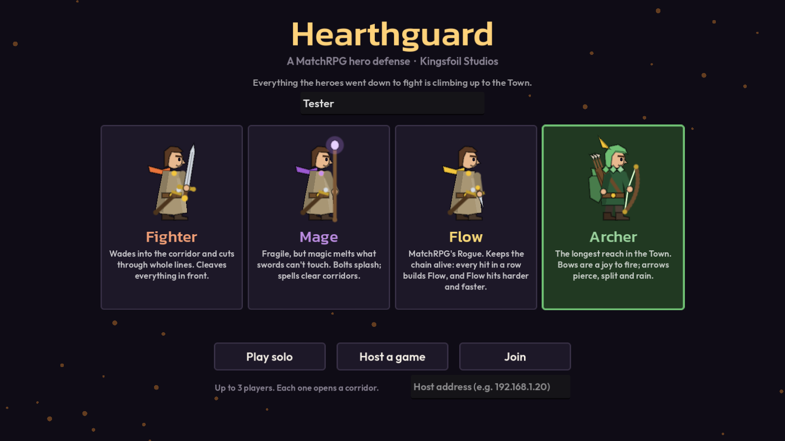
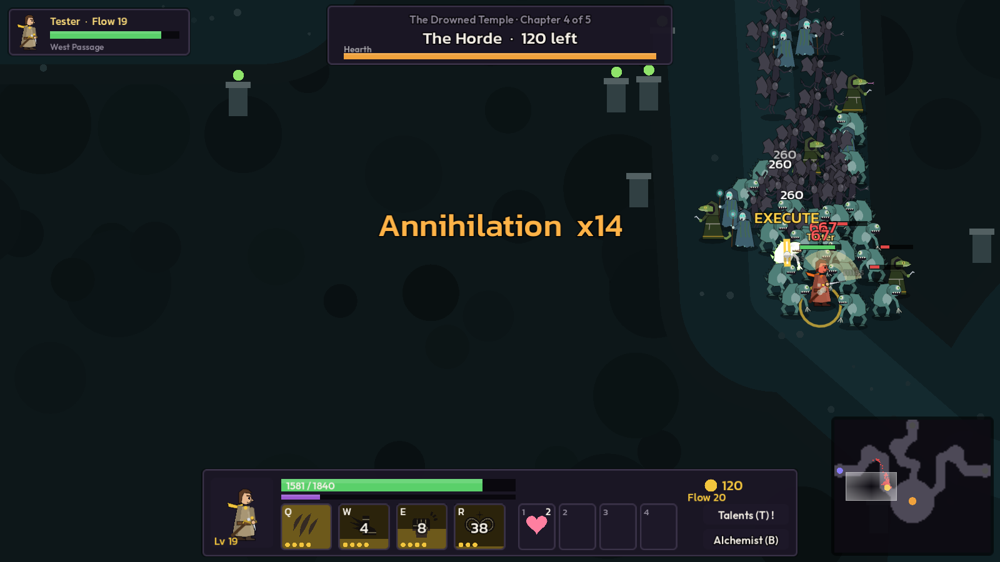
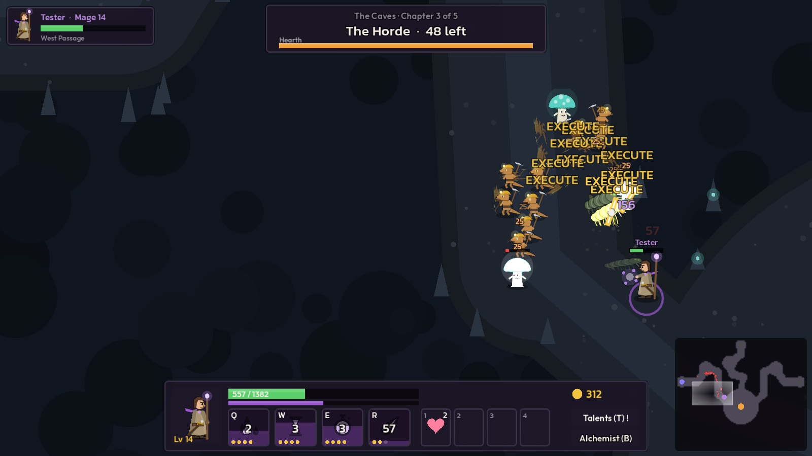
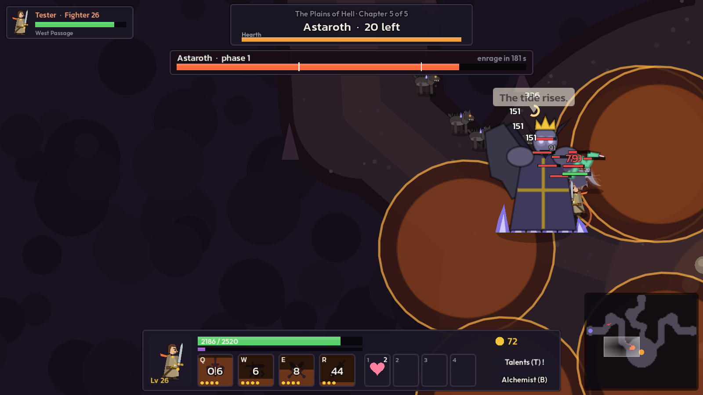
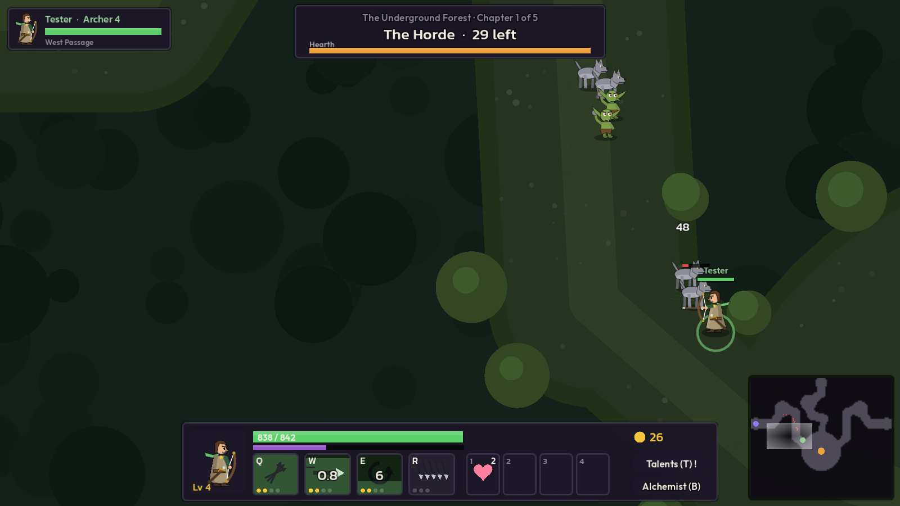

# Hearthguard

A co-op hero defense set in the world of MatchRPG (Ondoheer, Kingsfoil Studios). Everything the heroes went down to fight in MatchRPG is climbing up to the Town. One to three players hold the corridors and keep the Hearth lit through five chapters, one for each MatchRPG world, each ending with that world's boss.

Built with Godot 4.7, like MatchRPG, so its art code, sounds and fonts are used as they are.

## Run it

    godot --path .                      # play (menu: solo, host or join)
    godot --headless --path . --export-release "Web" build/web/index.html
    godot --headless --path . --export-release "macOS" build/mac/Hearthguard.zip

| | |
| --- | --- |
|  |  |
| Flow cuts into the Drowned Temple's Horde (chapter 4). | The Mage's spells push a Caves pack under the execute line (chapter 3). |
|  |  |
| The Fighter against Astaroth while the lava rises (chapter 5). | The Archer holds the West Passage in the Underground Forest (chapter 1). |

Screenshots come from `tests/shot.tscn` and `tests/menu_shot.tscn` (see Tests).

## Public test build

https://kingsfoil-hearthguard.netlify.app (Netlify project `kingsfoil-hearthguard`, Kingsfoil Studios team). The web build is solo for now: Host and Join show "Coming soon" (`SOLO_ONLY` in `scripts/ui/menu.gd`, on for web exports).

Every push to `main` deploys it. The GitHub Actions workflow in `.github/workflows/deploy.yml` downloads Godot, exports the web build, adds `deploy/netlify.toml` and deploys `build/web` to that project. Netlify can't run Godot, so the project is not linked to the repo on Netlify's side. The workflow needs two repository secrets, `NETLIFY_AUTH_TOKEN` (a Netlify personal access token) and `NETLIFY_SITE_ID`. Without them it builds and skips the deploy.

To deploy by hand, export the web build, copy `deploy/netlify.toml` into `build/web`, and run `netlify deploy --dir=build/web --prod --site kingsfoil-hearthguard`.

The playtest dashboard at https://kingsfoil-hearthguard-dashboard.netlify.app lists every logged play by player. See `dashboards/README.md`.

The same build plays on phones and computers; see "Touch" below. https://kingsfoil-hearthguard-mobile.netlify.app holds the first touch build and is not updated. The Netlify badge is turned off in both projects because it covered the Attack button.

## Play together

- One player hosts from the desktop build (or `godot --path .`). The menu shows the host's address. The game listens on port 7350 (WebSocket).
- Others pick "Join" and type that address, from the desktop build or the web build. A browser can join but can't host.
- Each player holds one corridor: slot 1 the West Passage, slot 2 the North, slot 3 the East. A corridor with no player stays shut with rubble and sends nothing, so a solo game is one corridor.
- A web build served over `https` can only reach a `wss://` host. For LAN play, serve the web build over plain `http` (for example `python3 -m http.server` in `build/web`).

## Controls

The lab preset's "moba" scheme.

| Input | Does |
| --- | --- |
| Right-click | Move, or attack the mob under the cursor |
| A, then click | Attack-move |
| S (hold) | Stand down: drop every order and ignore mobs while held (to walk to the Alchemist). On release the hero stands ready |
| H | Hold position |
| Q W E R | Cast. Aimed spells wait for a left click (F2 switches to quick cast) |
| Ctrl + Q W E R, or the gold "+" | Learn or rank up an ability |
| 1 2 3 4 | Drink a potion from the belt |
| T / B | Talents / the Alchemist (by the Hearth, or anywhere at the campfire) |
| Space (or Enter) | Call the next wave now, during any countdown. Pays gold for each second skipped. In co-op every player has to call |
| C / Y | Camera to your hero / switch between follow and free camera |
| Wheel, arrows, screen edges | Zoom and pan |
| F1 / Esc, or the Menu and ? buttons under the party list | Help / menu |

### Touch (phones and tablets)

One build serves phones and computers. Touch mode turns on for phones and tablets, and on any screen the moment a finger touches it. A real mouse click turns it off again. The menu's Controls row can pin it to Touch or Mouse instead of Auto, and `?touch=1` in the address forces touch for one visit. On a phone the HUD draws 1.2 times bigger (`Touch.hud_scale`), and the controls live in `scripts/ui/touch_pad.gd`.

| Touch | Does |
| --- | --- |
| Left thumb, anywhere on the left | A floating joystick. Moving with it ignores mobs (like holding S); let go and the hero fights again |
| Tap the field | Walk there, or attack the mob under the finger |
| Attack (big red button) | Attack the nearest mob |
| Q W E R round it | Tap to cast at the nearest mob in range (self spells go off at once). Drag off the button to aim, let go to cast. Drag back onto it to cancel |
| Gold + on a skill | Learn or rank it up |
| Bottom strip | HP, XP, gold, the potion belt (tap to drink), Talents and Alchemist. Tap outside an open panel to close it |
| II / ? (under the party list) | Menu / help |
| Call it (by the wave panel) | Next wave now, for gold |
| Two fingers on the field | Pinch to zoom |

### The menu

Esc, or the Menu button, opens it. In a solo game the match pauses while it is open; online it can't, so the menu only covers the screen. It has:

- Sound on or off, and volume sliders for music, effects and buttons. Each has its own audio bus (`Music`, `SFX`, `UI`, made in `scripts/autoload/sfx.gd`).
- Controls: Auto, Touch or Mouse.
- Leave the game.

The choices are kept in `user://settings.cfg`, which is the browser's storage on the web.

### Full screen

The web page has its own shell (`web/shell.html`) with a full screen button in the top right corner. It tries the standard API, then the WebKit, Firefox and old Edge names. Browsers only allow full screen from a tap or a key, so on a phone or tablet the page asks on the first tap and keeps asking on later taps until the browser agrees, then locks landscape where the browser allows it (Android Chrome). After that it stops asking, so a player who leaves full screen stays out until they press the button. On a computer the page only goes full screen from the button. Safari on iPhone has no full screen API: there the button explains how to add the game to the home screen, and the page carries the meta tags that make that copy open with no browser bars. Held upright, a phone shows "Turn your phone sideways".

### Accounts

The Sign in button in the top left of the title screen opens a panel for an email and password account on Supabase. Playing doesn't need one. `scripts/autoload/auth.gd` calls the Supabase Auth REST endpoints (`/auth/v1/signup`, `/auth/v1/token`, `/auth/v1/logout`) with `HTTPRequest`, because Godot has no Supabase SDK. The session is kept in `user://session.cfg`, and the access token is refreshed two minutes before its hour runs out.

The project URL and publishable key are in `project.godot` under `[supabase]`. The publishable key is safe to ship in the client. Never put the database password or the secret key there, because the web build hands every file to the browser. With the key empty, the Sign in button is hidden.

If "Confirm email" is on in the Supabase dashboard (Authentication > Sign In / Providers > Email), a new account gets a link by email and can only sign in after clicking it.

A player who hasn't signed in plays as a guest, a Supabase anonymous user, so their plays are logged too. This needs "Allow anonymous sign-ins" on in the dashboard. When a guest signs in or makes an account, their plays move to it. Before signing in, the guest asks the database for a claim code (`issue_guest_claim`). After signing in, the account sends it back (`redeem_guest_claim`), and the database moves every play and event the guest made.

### Play logs

Every play is stored in Supabase, for balance and debugging. The tables, security rules and guest claim functions are in `supabase/migrations/`.

- `plays` has one row per play and player. It has the mode, party size, hero, platform and build (`application/config/version`), how far the play got, the totals, and the outcome (`victory`, `defeat`, `quit` or `disconnected`). The row is updated every 20 seconds, so a play whose tab was closed still shows how far it got, with `ended_at` empty. `match_seed` is the same for everyone in a co-op match.
- `play_events` has what happened, as JSON in `data`. A `death` has the blow and the mob that dealt it (kind, rank, lane, its HP), every hit of the last 6 seconds by source, the hero's whole state (stats, ranks, talents, belt, cooldowns, buffs and debuffs), the potions left, the mobs, elites and boss near, and the nearest ally. A `hero_wave` sums up each wave per hero: damage done, damage taken by source, kills, deaths, time dead, casts per skill and potions drunk. There are also `wave_start`, `wave_end`, `level`, `learn`, `talent`, `loot`, `buy`, `drink`, `respawn` and `game_over`.

`scripts/game/telemetry.gd` makes the records on the host from the Sim. They go to the players along with the game's other events, and each player's `PlayLog` (`scripts/autoload/play_log.gd`) stores the records about their own hero. Only the host stores the match records (slot -1). Damage sources are names like `skeleton`, `zone:lich:curse` (a boss or elite move, kept through `Sim.blame`) or `poison:giant_spider`. Logging changes nothing in the game: a seeded `sim_bot` run plays the same with and without it.

Records go in batches. What can't be sent is kept in `user://play_log_queue.json` and sent on the next start. A 15 minute game makes about 200 records and 50 KB.

Players can only write what the game writes. The column grants allow inserting a play's details and updating its summary, nothing else, and there is no delete. Checks cap the values (level, chapter, sizes), a play at 10,000 events, and a player at 30 new plays an hour. `started_at` comes from the game, so a play logged offline keeps its real start; `received_at` is the server's time.

A player can still send made-up numbers that pass the checks, since the game writes its own logs. That's fine for balance work. Before a leaderboard, see the replay verification plan in `docs/todo.md`.

## What comes from where

### The rts-playtest-lab preset

`Dota_2.json` is the exported "dota" preset with its diff (cooldown 630 ms, no wind-up, 400 ms backswing, 10 ms hit stop, damage numbers on). `scripts/autoload/tuning.gd` reads it at start, and the game takes its timings from it unchanged: tick rate, attack cooldown, wind-up, backswing and backswing cancel, turn rate and the 12 degree move-turn limit (the "heading" movement model), cast point, AoE delay, dash distance, hit stop, flash, shake, particles, aggro radius, wave gap, hero HP and respawn. Distances and speeds are scaled by 2.5 (`Tuning.WORLD`) from the lab's units to this map's pixels.

Two choices differ from the preset, for feel. The camera follows your hero by default (the preset says "free"; Y gives it back). Enemy HP and damage are this game's own, per chapter (see `ChapterDefs`).

### MatchRPG

- **Art.** MatchRPG ships no image files: every hero, enemy and icon is drawn in GDScript. Those scripts are copied into `scripts/matchrpg/` and used as they are: `EnemyLook` and `EnemySprites` (all 42 creatures, elites and bosses), `HeroLook`, `HeroArt` and `HeroSprites` (the heroes, whose gear grows with each talent taken), `EnemyMissile` (thrown rocks, bones, bolts), `TalentIcon`, `TileIcon` and `IconShapes` (ability and talent icons), the potion symbols (`PotionArt`, taken from `PotionSlot`), and `Kept`. The changes are marked "Hearthguard" in the files: the Archer drawing and its bow (new, in the same hand), a bow "aim" pose, and small shims where MatchRPG's lookups (RowDefs, UiTheme) aren't here.
- **Sound, music and fonts.** All of `assets/audio` (each world's calm, tense and boss music, the bosses' roars, hits, potions) and the Kanit and Outfit fonts.
- **Lore and numbers.** The five worlds in order, their rosters, elites and bosses, names, colors, lore lines and sword/staff weaknesses (`MobDefs`, from `EnemyDefs` and `WorldDefs`), the world backdrops' palettes (`ChapterDefs`), the elites' and bosses' signature mechanics reworked as area moves (`Brains`), MatchRPG's potions on a four-slot belt (`PotionDefs`), its class names and branch colors, and its talent names.

### The enemy AI study

The study's advice was to start simple and fun-first before trying anything clever. `Sim` and `Brains` follow its build order up to step 8, and stop there on purpose.

| Study step | Here |
| --- | --- |
| Flow field, one per destination | `MapData` builds one field to the Hearth; every marching mob reads it |
| Mob FSM with leash, aggro, camp/wave split | Every mob is a wave marcher. A mob notices a hero within its threat range (ranged mobs 20% past their reach, melee mobs 340 px, chargers 460 px) and drops them past the same distance, then marches on to the Hearth. A hit holds a mob on its attacker for 3 s at any distance and turns the marching mobs within 140 px with it. A hero who hides or runs too far leaves the crowd to the Hearth |
| Attack tokens and the hate ring | 6 melee and 4 ranged tokens per hero, plus 1 per chapter. Mobs without a token circle the hero and never stand still. Tokens are counted again every 2 s |
| Separation and speed variation | Soft separation on a spatial hash, plus or minus 10% speed, 0.15-0.35 s reaction jitter. Heroes wade through crowds |
| Wave commander and director | `Director` runs the cycle: build up (packs), peak, relax (the preset's 12 s gap). It only paces, it never adjusts stats. Bosses are left out of pacing |
| Boss phases, weighted moves, anti-repeat, telegraphs | One-way phases at 70% and 35%, an enrage timer, 3-4 moves per boss with weights, cooldowns and range bands. A move's weight halves with each recent use. A shared cooldown sits between big moves, and every move has a telegraph and a recovery window to punish |
| Threat table, barks, name cards | Damage is threat, with switching at 110% (melee) and 130% (ranged). Bosses bark their intent, and elites and bosses get name cards with their MatchRPG lore |
| Ranged kiting | Ranged mobs hold a ring at their reach and back off when you close in |

Steps 9-11 (influence maps, adaptation, learned models) are left out. The study ranks them below readable fights.

## The game

- **Calling waves.** Every countdown (the intro, the 12 s gap, the campfire) can be cut short with Space. Each hero gets 2 gold a second skipped, times the chapter's gold multiplier.
- **Auto-attack** picks up mobs within 105% of a ranged hero's reach and twice a melee hero's, so an idle hero doesn't run at mobs it hasn't met.
- **Gold.** Kill gold grows 70% a chapter. Meteor (150), Aegis (240), Cataclysm (320) and Clone (160) cost enough to be a last resort.
- **Five chapters, six waves each.** Two plain waves, the world's first elite (wave 3), the Horde (wave 4: three surges, each a wall of mobs out of the portal at once), the second elite (wave 5), then the world boss with adds streaming down every open corridor. A 25 s campfire break comes between chapters: full heal, the Alchemist, half the Hearth back.
- **Mobs** have four brains. Fodder bites. Ranged mobs throw MatchRPG's missiles and kite. Brutes hit hard. Chargers (the Boar) wind up a telegraphed dash. Many have a small trait: webs and spores slow, vines root, the gnome hexes, serpents poison, hellhounds burn, the Gibbering Mass splits, Ualac drops gold.
- **Elites** use their MatchRPG move as an area attack. The Ogre King throws rocks, the Broodmother webs and births spiders, and the Lich curses a hero, which bursts on allies near them. The Orc Warlord's war cry speeds the crowd, the Crystal Golem spins, and the Matriarch drops poison. The Hierophant's ritual summons unless you break it with 12% of its HP, the Shoggoth slams tentacles, Amdusias' songs swap his immunity, and Belial charges trailing fire.
- **Bosses.** Old Mossback regenerates until wounded, and a hard hit staggers his Log Slam. The Warden shackles, throws his ball and chain, and locks down a ring. The Deep Wyrm burrows under you, breathes and sweeps, and turns out the lights in its last phase. The Sleeper Below reaches with tentacles, stuns with its gaze, slips the angles and dreams. Astaroth raises the lava, seals the ground and calls a hellstorm.
- **Heroes.** The Fighter (Blade) cleaves. The Mage (Arcane) splashes. Flow (MatchRPG's Rogue) builds Flow with every hit in a row. The Archer (new) has the longest reach. Each has Q W E and an ultimate R.
- **Growth** mixes Warcraft III and MatchRPG. Every level gives a point for Q/W/E (ranks 1-4 at levels 1/3/5/7) or R (ranks 1-3 at 6/11/16). At levels 4, 8, 12, 16 and 20, each class picks one of three talents in a MatchRPG talent row (5 rows x 3 per class, 60 in all). Every talent taken also dresses the hero one rank further in MatchRPG's art.
- **Power curve.** Hero damage grows 9% a level, faster than a chapter's mobs, so a chapter ends in a mow and the next one's first wave pushes back. Every mob dies to any hit under 8% HP (an execute with a gold cut and a beat of slow motion), and talents raise that line.
- **Feel.** Hit stop and flash from the preset. Big hits and AoE kills fling bodies, executes get their own flourish, multikills call out ("Rout", "Slaughter", "Massacre", "Annihilation"), and the camera kicks on slams and booms.

## Code

| Path | What |
| --- | --- |
| `scripts/game/sim.gd` | The host's simulation: mobs, damage, the Hearth, snapshots |
| `scripts/game/director.gd` | Waves, hordes, campfire, victory |
| `scripts/game/brains.gd` | Elites and world bosses |
| `scripts/game/skills.gd` | Attacks, abilities, talent hooks, potions, the Alchemist |
| `scripts/game/hero_control.gd` | Your hero, moved on your screen (no network wait) |
| `scripts/game/game.gd` | The match: tick, network messages, camera |
| `scripts/game/view.gd`, `map_view.gd` | Drawing the field |
| `scripts/ui/hud.gd`, `menu.gd` | HUD, menu and lobby |
| `scripts/data/` | Mobs, chapters, classes and talents, potions |
| `scripts/autoload/` | `Tuning` (the preset), `Sfx`, `Net` (lobby and connection) |
| `scripts/matchrpg/` | MatchRPG's drawing code |

The host runs the only `Sim`. Each client moves its own hero and sends its position (15 a second), attacks and casts. The host sends events (reliable, every tick), a packed mob snapshot (12 bytes a mob, 15 a second) and hero state (10 a second). The host's own screen draws from the same snapshots and events as a client's.

## Tests

    godot --headless --path . res://tests/check_compile.tscn                    # every script compiles
    godot --headless --path . res://tests/sim_bot.tscn -- --cls=archer --minutes=60   # a bot plays the whole game
    godot --headless --path . res://tests/sim_bot.tscn -- --players=3 --cls=fighter,mage,archer --god
    godot --headless --path . res://tests/net_test.tscn -- --role=host --players=2    # then, in another shell:
    godot --headless --path . res://tests/net_test.tscn -- --role=client
    godot --path . res://tests/shot.tscn -- --cls=mage --chapter=3 --wave=3 --times=12   # screenshots to tests/shots
    godot --path . res://tests/menu_shot.tscn                                            # the menu, to tests/shots/menu.png

The bot stands at its gate, never dodges a telegraph, never chases a mob that walks past and never buys a potion, so its results are a floor for what a person does. Latest runs (after the threat-range change): a solo Mage bot wins all five chapters, Flow falls at the chapter 4 horde, the Archer at the chapter 3 horde, the Fighter at the chapter 3 boss, and a Fighter, Mage and Archer team at the chapter 4 boss. `--rush` makes the bot call every wave early. The host simulation costs about 0.3 ms a tick with three corridors of horde.
